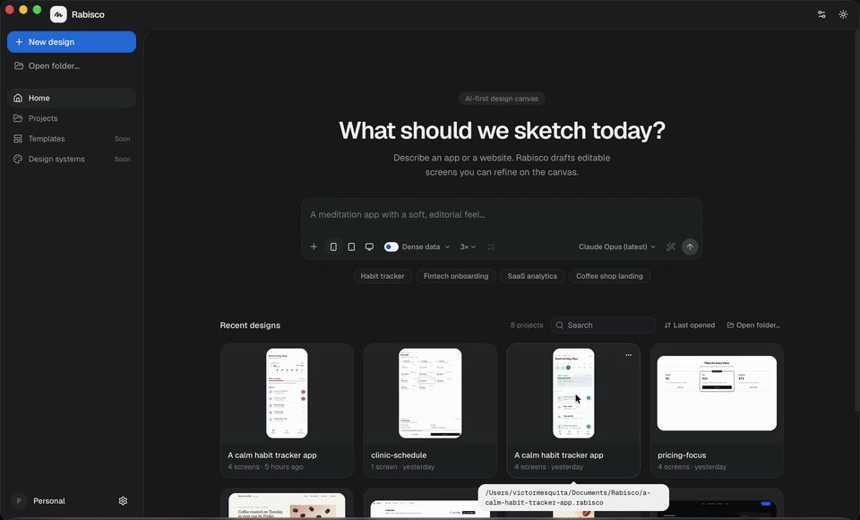
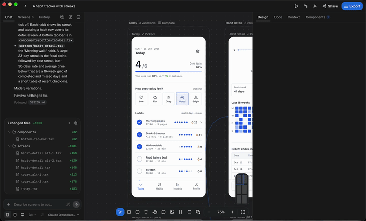
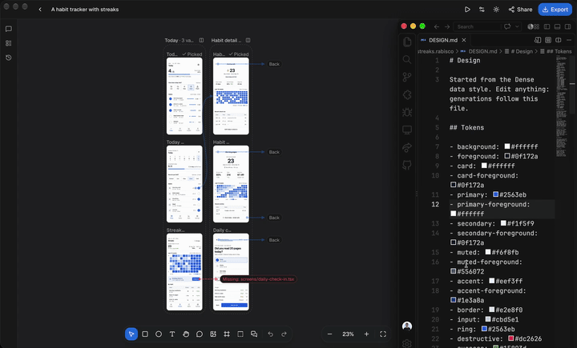

<p align="center">
  
</p>

<h1 align="center">Rabisco</h1>

<p align="center">
  <strong>Describe an app. Get React screens you can edit, own and ship.</strong><br>
  An AI design canvas that runs on your Mac, writes real React + Tailwind, and uses the AI you already pay for.
</p>

<p align="center">
  <a href="https://github.com/victor-teles/rabisco/releases/latest"></a>
</p>

<p align="center">
  <a href="LICENSE"></a>
  <a href="https://github.com/victor-teles/rabisco/releases"></a>
</p>

<p align="center">
  
</p>

## Why Rabisco

- **Local-first.** A project is a folder on your disk. No account, no cloud. Your designs never leave your machine unless you push them.
- **Real React/TSX.** Every screen is a React component styled with Tailwind and shadcn/ui. What you see is what you ship. There's no conversion step.
- **Bring your own AI.** Use Claude Code, Codex CLI, Antigravity CLI, Ollama, or an API key for Anthropic, OpenAI or OpenRouter. No credits: your Claude Code plan already covers it.
- **Git-friendly.** Screens are `.tsx` files and `DESIGN.md` is plain Markdown. Review a design change in a pull request.
- **Undoable.** Every AI edit goes through history, and history survives restarts. Every AI change is one ⌘Z away.

## How it works

1. **Describe** the app on the Home screen. Pick mobile, tablet or desktop, and how many variations.
2. **Refine** on the canvas: select any element and say what to change, or edit it directly. Classes, text and layout are written back to the TSX.
3. **Ship**: copy the code, or export a runnable Vite + React + Tailwind project.

Free and open source (MIT). The app works with no AI configured: you can open and edit any project without a provider.

|                                                                               |                                                                                  |
| ----------------------------------------------------------------------------- | -------------------------------------------------------------------------------- |
|  |  |

See [docs/PRINCIPLES.md](docs/PRINCIPLES.md) for how Rabisco makes decisions and [docs/ROADMAP.md](docs/ROADMAP.md) for what comes next. Finished work is in [docs/ROADMAP-ARCHIVE.md](docs/ROADMAP-ARCHIVE.md).

## Getting started

```bash
curl -fsSL https://hutch.blackboard.sh/hutch/install.sh | sh   # once
hutch run install     # dependencies (delegated to Bun, see hutch.config.ts)
hutch run dev         # build the UI and launch the app, rebuilding on changes
hutch run dev:hmr     # same, but with the Vite dev server and hot reload
```

Other tasks: `hutch run typecheck`, `hutch run lint` (oxlint with the vendored [anti-slop](tools/oxlint/anti-slop/UPSTREAM.md) rules), `hutch run fmt` (oxfmt), `hutch run build` (stable), `hutch run build:canary`, `hutch run bench:gen` (the generation eval, see [bench/gen](bench/gen/README.md)).

The UI also runs in a plain browser: `hutch run hmr`, then open http://localhost:5173. Outside Electrobun the RPC layer falls back to localStorage.

## Layout

```
src/
  bun/                  main process (Cottontail)
    index.ts            window and RPC handlers
    store.ts            project folders, recents and file watching
    ai/                 provider layer (decision 0003): settings, keychain, validation, repair loop
      providers/        Anthropic, OpenAI-compatible, Claude Code, Codex, Antigravity CLI, Claude Agent SDK
  shared/               types, RPC schema, the AI contract and the dev-only mock generator
  mainview/             webview (React)
    lib/rpc.ts          typed RPC client and browser fallback
    lib/project-sessions.ts  open projects and their generations, kept while work runs (decision 0021)
    views/home.tsx      prompt hero and recent projects
    views/editor/       chat panel, infinite canvas, inspector
    components/ui/      shadcn primitives, uai blocks in ui/uai
```

## UI kit

Add shadcn primitives with `bunx --bun shadcn@latest add <name>`, and uai blocks with
`bunx --bun shadcn@latest add @uai/<name>` (the registry is configured in `components.json`).
The CLI sometimes writes `from "cn"` instead of `@/lib/utils`; fix the import if it does.

## Canvas shortcuts

| Key                                                       | Action                                                                            |
| --------------------------------------------------------- | --------------------------------------------------------------------------------- |
| `V` / `H` / `C`                                           | Move / hand / comment tool                                                        |
| `R`, `O`, `T`                                             | Rectangle, ellipse, text tool: click or drag inside a screen to add               |
| `⇧⌘K`                                                     | Place an image from a file at the pointer (copied into `public/images/`)          |
| `Esc` (insert tool on)                                    | Back to the move tool                                                             |
| `Space` + drag                                            | Pan                                                                               |
| Scroll / ⌘ + scroll                                       | Pan / zoom                                                                        |
| `⇧1`                                                      | Zoom to fit                                                                       |
| `⇧2`                                                      | Zoom to selection: the selected element, else the selected screens                |
| `⇧0` or `⌘0`, `⌘+`, `⌘-`                                  | Zoom to 100%, zoom in, zoom out                                                   |
| `⌥` + hover                                               | Measure: distances from the selection to the hovered element or its parent        |
| `⌃G`                                                      | Show or hide layout grids (add one to a screen in the inspector)                  |
| `I` (element selected)                                    | Eyedropper: pick a fill from any screen, or for the open color field              |
| `⌘D`, `⌫`                                                 | Duplicate, delete the selected screen                                             |
| `⌘R`                                                      | Rename the selected screen                                                        |
| `⌥N`                                                      | New blank screen (presets in the toolbar and the canvas menu)                     |
| `⇧S`, or Section in the toolbar                           | Section around the selected screens, or drag on the canvas to draw one            |
| Drag a section's name / double-click it                   | Move it with its screens / rename it; right-click for color and delete            |
| `⌫`, `⌘R` (section selected)                              | Delete the section (keeps its screens), rename it                                 |
| Click a section's empty area, then drag an edge or corner | Select it, then resize it; screens whose center ends up inside join it            |
| `⌘F` (canvas)                                             | Find and replace text across screens; `↵` steps through the results               |
| Double-click a screen's label                             | Rename it in place                                                                |
| Drag a selected screen's edge or corner                   | Resize the screen (`⇧` keeps the ratio, `⌥` from the center)                      |
| `⌥1`                                                      | Screens list, or back to the chat                                                 |
| `⌥↑` / `⌥↓` (Screens list)                                | Move the focused screen up / down                                                 |
| `⇧⌘\`                                                     | Show or hide the chat and screens panel                                           |
| `⇧⌘O`                                                     | New chat                                                                          |
| `/` in the chat                                           | Chat commands: Rabisco's own and your CLI's commands                              |
| `⌘I` in a prompt (Home or chat)                           | Improve prompt: expand it into a brief to edit; `⌘Z` puts the original back       |
| `⇧⌘P` in a prompt (Home or chat)                          | Plan first: new screens wait as a plan you approve; a reply revises the plan      |
| `↵` / `Esc` (plan card focused)                           | Generate the plan's screens / cancel the plan                                     |
| Double-click the title bar                                | Zoom the window (follows the macOS setting)                                       |
| `⌥C`                                                      | Comments list                                                                     |
| `⌥⌘S`                                                     | Save a checkpoint in version history (a git commit when git is set up)            |
| `⌘C`, `⌘V`                                                | Copy the selected screens, paste screens or screen code as new screens            |
| Drop or paste (`⌘V`) an image on the canvas               | Add it to the moodboard; it goes with prompts about the screen it sits next to    |
| `⌫` (moodboard image selected)                            | Delete the image; drag a corner to resize it (`⇧` frees the ratio)                |
| Right-click a screen, element or the canvas               | Every action for what's under the pointer, with its shortcut                      |
| `⌘K`                                                      | Command palette: every action, searchable                                         |
| `?`                                                       | Keyboard shortcuts                                                                |
| Click inside the selected screen, or `⌘`-click            | Select the element under the pointer (hover shows its name and size)              |
| `⇧`-click (element selected), `⇧`/`⌘`-click (Layers)      | Add or remove an element from the selection; style edits apply to all             |
| Double-click, or `Enter` on an element without children   | Edit its text in place (`Enter` keeps it, `Esc` cancels)                          |
| `Enter` / `⇧↵` or `Esc`                                   | Select the first child / the parent (`Esc` first goes back to one element)        |
| `⇥` / `⇧⇥`                                                | Select the next / previous sibling                                                |
| Arrow keys (element selected)                             | Move it earlier / later along the parent's direction (by row in a grid)           |
| `⌥A` `⌥H` `⌥D`, `⌥W` `⌥V` `⌥S`                            | Align the selected elements, or screens, left, center, right, top, middle, bottom |
| `⌃⌥H`, `⌃⌥V`                                              | Distribute the selected elements, or screens, horizontally, vertically            |
| Drag an element in the selected screen                    | Move it within its parent, into another container or into another screen          |
| Drag an item of a list (`.map`) in the selected screen    | Reorder it among the list's items                                                 |
| Drag an edge or corner handle                             | Resize (`w-*`/`h-*`, snapped); double-click a handle to hug                       |
| Drag a padding or gap bar                                 | Change padding or gap (`⌥` all sides, `⇧` both opposite sides)                    |
| `⌫` (element selected)                                    | Delete it                                                                         |
| `⌘D`, `⌘C`, `⌘X`, `⌘V` (element selected)                 | Duplicate, copy, cut, paste after it (between screens too)                        |
| `⌥⌘G`, `⇧A`, `⇧⌘G` (element selected)                     | Wrap in a div, wrap in a flex stack, unwrap                                       |
| `⌥⌘C` / `⌥⌘V` (element selected)                          | Copy its classes without `md:`/`hover:` variants / paste onto the selection       |
| `⇧⌘H` (element selected, or the eye in Layers)            | Hide or show: writes `hidden` in the TSX                                          |
| `⇧⌘L` (element selected, or the lock in Layers)           | Lock or unlock: the canvas can't select, move or resize it; Layers still can      |
| `⌥⌘A` (element selected)                                  | Select matching: the same component, or the same classes, in the screen           |
| Prompt with elements selected                             | Change only those elements (point and prompt)                                     |
| `⌥2`                                                      | Components panel: project components, the shadcn library and suggestions          |
| `/` or `⌘F` (Components panel open)                       | Search components                                                                 |
| Drag from the Components panel                            | Add the component to the screen under the pointer                                 |
| `⇧D`                                                      | Code tab: the selected screen's or component's structure and editable source      |
| `↑` `↓` / `←` `→` (Structure)                             | Move through elements / collapse, expand                                          |
| `⌥⌘K` or `Enter` (Structure)                              | Make component from the selected element, and replace its repeats                 |
| `⌫` (Structure)                                           | Delete the selected element                                                       |

## License

MIT. See [LICENSE](LICENSE).

Vendored code keeps its own license:

- `tools/oxlint/anti-slop/`: MIT, see its [LICENSE](tools/oxlint/anti-slop/LICENSE) and [eslint-stylistic LICENSE](tools/oxlint/anti-slop/vendor/eslint-stylistic/LICENSE).
- `src/mainview/components/ui/`: [shadcn/ui](https://ui.shadcn.com), MIT, see its [LICENSE](src/mainview/components/ui/LICENSE.md).
- `src/mainview/components/ui/uai/`: blocks from [uai](https://uaiblocks.vercel.app).
